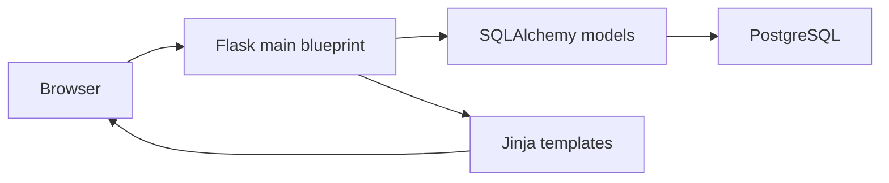

# Architecture and workflows

## Request flow

`run.py` calls `create_app()` in `app/__init__.py`. The factory loads `Config`, initializes Flask-SQLAlchemy and Flask-Login, and registers the `main` blueprint from `app/routes.py`.

Routes read HTML form fields, query or update the database, and return rendered pages or redirects. Successful writes generally redirect after committing. Error handling varies: account and job routes catch some database errors, while several profile, application, and interview writes have no rollback handler.

## Authentication and roles

Signup hashes the password with Werkzeug, inserts a user, and stores `user_id` and `role` in Flask's signed session. Login verifies the password and sets the same values. Logout clears the session. `/dashboard` redirects students to `/student_view` and administrators to `/admin/view`.

Most protected routes compare `session['role']` with a literal role. Flask-Login is initialized and has a user loader, but the handlers do not call `login_user()` or use `login_required`. Authentication currently relies on Flask sessions rather than Flask-Login. The user model uses `user_id` without overriding `UserMixin.get_id()`, so a complete Flask-Login integration would also require that override.

Role checks are incomplete. See the [route reference](routes.md) for the checks actually present.

## Student workflow

1. Create a student account or log in.
2. Edit the student profile. A missing profile is created when the update route is first visited.
3. Browse jobs or search titles and descriptions. Search uses PostgreSQL-style case-insensitive matching through SQLAlchemy `ilike`; results are not paginated.
4. Open a job and submit a cover letter. The handler checks for an existing application before inserting another.
5. Read decisions and scheduled interviews on the student dashboard.

The composite application primary key allows one application per student and job. Applications cannot be withdrawn or edited through the UI.

## Administrator workflow

1. Log in with an admin account and optionally edit the admin profile.
2. Create a job using an existing company ID. Both `/admin/create_job` and `/add_job` implement creation, but their shared form posts to `/add_job`.
3. View jobs posted by the current administrator, then edit or delete a listing.
4. Review applications and accept or decline them. Accept writes `approved`; decline writes `rejected`.
5. Open the scheduling page, which lists applications with status `approved`, and select an interview date and time.
6. View all scheduled interviews.

The job list is scoped to the current administrator. The application and interview lists are global. Job edit and delete handlers check the admin role but do not check ownership of the requested job.

## Presentation

Twenty templates define the UI. Some extend `base.html`, which loads Tailwind from a CDN and the Inter font from Google Fonts and renders flash messages. Other templates are complete HTML documents with their own inline CSS and navigation.

The homepage embeds a remotely hosted image. There is no JavaScript application bundle, CSS build pipeline, asset bundler, or checked-in screenshot set. `dashboard.html` is unused by the current route handlers.

## Dates and values

Interview forms submit a timezone-free `datetime-local` value. The server parses it with `%Y-%m-%dT%H:%M` and stores a naive datetime. No timezone conversion, conflict detection, or future-date validation is implemented. Job timestamps use `datetime.utcnow`; several other timestamps use database defaults.

Salary is a floating-point value with no currency or pay-period field. The application does not define either convention.
